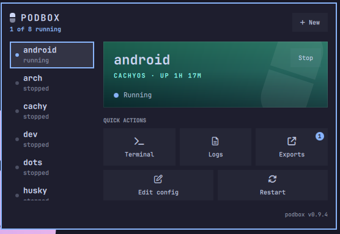

# Podbox for Omarchy

[](LICENSE)
[](https://github.com/bethropolis/omarchy-podbox-plugin/actions)
[](https://omarchy.org)
[](https://github.com/tcballard/omarchy-badges)


An Omarchy Quattro `bar-widget` + `overlay` plugin for
[`podbox`](https://github.com/bethropolis/podbox), a Podman-native
container environment manager. The bar shows how many environments are
running; the panel gives you one-click status, terminal, logs, config,
restart, build and exports.


## Previews




## Requires

* Omarchy Quattro (`omarchy-shell`)
* `podbox` >= 0.9.3 with the `watch`, `stats` and `export list` commands
* `podman`, which podbox depends on

0.9.3 is the minimum because the panel is built around the `watch --output
ndjson` event stream, the optional `status` extras (base image, start time)
and `export list --output json`. Older podbox builds still render the list,
but details and exports stay blank and status changes fall back to polling.

## Install

### podbox

This plugin is a frontend, you need podbox first. On Arch Linux, install
from the AUR using your preferred helper:

```bash
yay -S podbox-bin   # prebuilt, x86_64
# or
yay -S podbox       # source build
```

Both pull in `podman`. podbox has no daemon, so there is nothing to
enable: commands talk to podman directly. Create an environment with
`podbox init -i` if you have none yet; the panel's **+ New** tile runs
the same flow. See the official [`podbox`
repo](https://github.com/bethropolis/podbox) for profiles and config.

### Plugin

```sh
omarchy plugin add https://github.com/bethropolis/omarchy-podbox-plugin.git --enable
```

## Usage

* Bar: a small monochrome pill and the number of running environments
  (dimmed with a dash when podbox is missing, with a red dot when any
  environment failed). Left-click toggles the panel, middle-click
  refreshes, tooltip shows `N of M running`.

* Header: `N of M running` under the wordmark, plus **+ New**, which starts
  the interactive `podbox init -i` flow in a terminal.

* Rail: one row per environment with a status dot, name and state word
  (`running`, `stopped`, `failed`, `not built`). The selection marker
  glides between rows; Up/Down move the selection and scroll it into view.

* Hero card: OS-coloured gradient with the distro and uptime subtitle, and
  a live status line (`● Running · 35% cpu · 2.6 GiB · 95 procs`) whose dot
  pulses while running. The primary tile is **Start** when stopped or
  failed, **Stop** when running (Cancel is preselected in the confirm), or
  **Build** when the environment is not built. Switching environments
  morphs the card to their OS colour.

* Quick actions: **Terminal** (`podbox enter`), **Logs** (`podbox logs -f`),
  **Exports**, **Edit config** (`podbox edit`) and **Restart**
  (`systemctl --user restart NAME.service`). All run in your terminal
  through `omarchy-launch-tui` where one is needed, and dim when the
  selected environment cannot accept them. Tiles dip on press.

* Exports overlay: a centred Apps/Commands dialog. Apps are searchable and
  show the `.desktop` name with an **Export** / **✓ Exported** button;
  Commands can be added by name and show their shim path. **Remove all**
  (confirm first) cleans up everything podbox exported for that
  environment. Escape or a backdrop click closes it. App export needs a
  running environment, since podbox reads the `.desktop` files from it.

* Shell-driven like any other widget:

  ```sh
  # Open the Exports overlay:
  omarchy-shell shell summon io.github.bethropolis.podbox '{"env":"android","tab":"apps"}'
  omarchy-shell shell hide io.github.bethropolis.podbox
  omarchy-shell shell toggle io.github.bethropolis.podbox
  omarchy-shell shell call io.github.bethropolis.podbox refresh
  ```

  > This plugin declares both `bar-widget` and `overlay` kinds, so
  > `summon` reaches the **Exports overlay**, not the main panel. Open the
  > main panel by clicking the bar pill.

* Footer: right side shows the live `podbox v<version>` (git describe
  suffixes stripped). There is no gear: the shell has no per-plugin
  settings surface.

## How it works

The panel is stream-first. One long-lived `podbox watch --output ndjson`
feeds all environment status changes, so the bar count stays live with the
panel closed. If the stream dies three times it falls back to `podbox list`
polling (10s closed, 5s open) with backoff. While the panel is open,
`podbox stats NAME --no-stream --output json` refreshes the status line
every 2s, and `podbox status NAME --output json` runs on selection change.
The Exports overlay owns a second, on-demand model with watch and polling
off — it spawns nothing in the background, so there is only ever one watch
stream, even with both surfaces open.

Steady state is one watch child process; list polling is six short CLI
calls a minute while the panel is closed. Fire-and-forget actions go
through `Quickshell.execDetached`, reads and writes through managed
`Process` blocks in `PodboxModel.qml`. Environment and item names are
validated against `^[A-Za-z0-9_.-]+$` before reaching any command; every
command is an argv array, never a shell string. A missing podbox is probed
again on panel open, not on every tick. No second Quickshell process.

Pure parsing, formatting, distro detection and argv building live in
`Podbox.js` (Qt-free, testable under bun):

```sh
bun test tests/
omarchy plugin validate .
qmllint -I "$OMARCHY_PATH/shell" BarWidget.qml Panel.qml ExportsOverlay.qml \
  PodboxModel.qml components/*.qml
```

## Files

| File | Purpose |
|---|---|
| `manifest.json` | Plugin contract (`bar-widget` + `overlay` entry points) |
| `BarWidget.qml` | Bar button, owns the model and the panel loader |
| `Panel.qml` | Popover: header, rail, hero, quick actions, footer |
| `ExportsOverlay.qml` | Centred exports dialog (apps and commands) |
| `PodboxModel.qml` | All processes, timers, polling and derived UI state |
| `Podbox.js` | JSON parsing, formatting, colours and CLI argv builders |
| `components/` | Rail, Hero, ActionTile, StatusDot, PillLogo, TileButton |
| `assets/` | Pill SVG and preview source |
| `tests/` | Bun unit tests, structural QML guards and real CLI fixtures |
| `preview.png` | Marketplace preview |

## Customization

Move the widget in the bar:

```sh
omarchy bar move io.github.bethropolis.podbox --section right
```

The `osColors` setting in `shell.json` colours the hero card per distro.
It is a comma-separated list of `name=#hex` pairs; bad entries are
ignored and a distro falls back to its family, then `default`:

```
fedora=#3c6eb4,arch=#1793d1,ubuntu=#e95420,debian=#d70a53,alpine=#0d597f,cachy=#00b4a0,nixos=#7ebae4,opensuse=#73ba25,default=#6366f1
```

To add a quick action:

1. Add an argv builder in `Podbox.js` (pure function, covered by bun).
2. Add an `ActionTile` in `Panel.qml`, using a glyph from `Podbox.ICONS`
   that is also listed in `ICON_CODEPOINTS` (icons are font-probed at
   startup).
3. Wire the signal to a spawn function in `PodboxModel.qml`: reads and
   writes in managed `Process` blocks, fire-and-forget through
   `Quickshell.execDetached`.

Icon glyphs and labels never share a `Text` in the bar; the pill and the
count are separate runs so an icon font can never split the figures.

## Remove

```sh
omarchy plugin remove io.github.bethropolis.podbox
```

This deletes the plugin folder; the shell drops the bar widget
automatically. podbox, its environments and its Podman containers stay
installed — remove those separately with `podbox remove NAME` if you no
longer need them.

## License

MIT. See [LICENSE](LICENSE).
